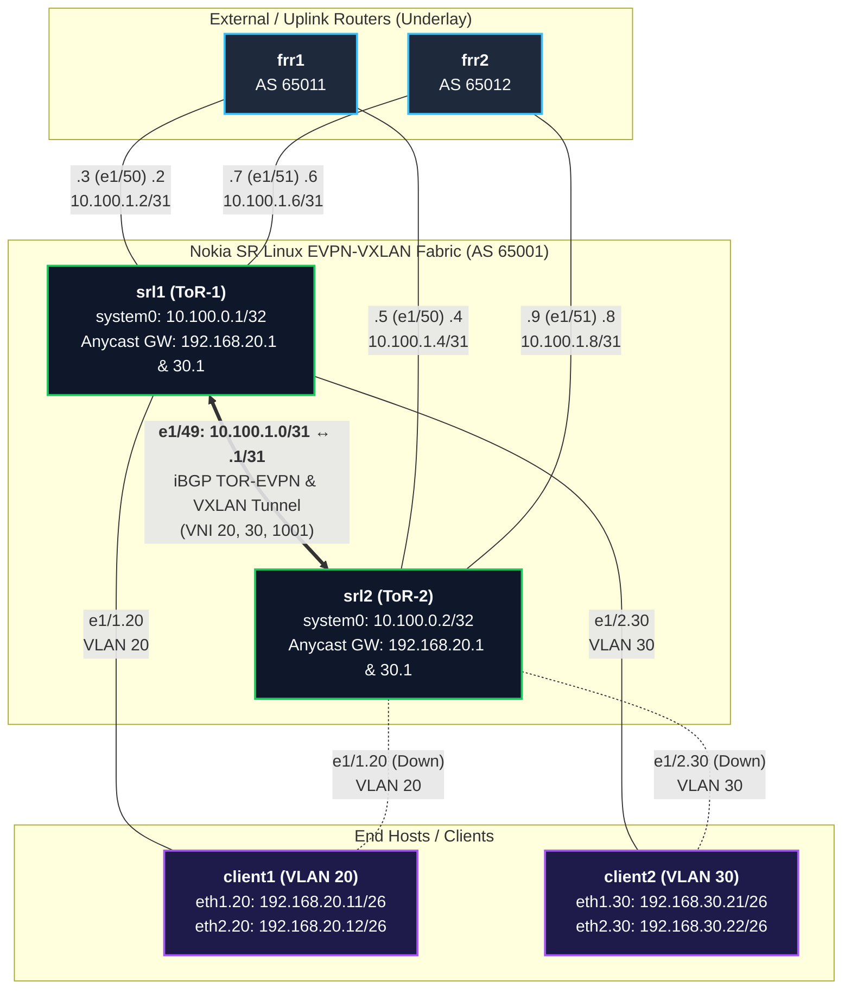

# Nokia SR Linux EVPN-VXLAN Symmetric IRB Lab

This repository contains the topology, configurations, and verification steps for a **Direct ToR-to-ToR EVPN-VXLAN Symmetric IRB** fabric built using **Nokia SR Linux 23.10**, **FRRouting (FRR)**, and Linux hosts running on **Clabernetes (Containerlab on Kubernetes)**.

## Architecture Overview

* **Underlay Network:** Point-to-point `/31` links interconnecting the ToR switches (`srl1`, `srl2`) and external border routers (`frr1`, `frr2`). Loopback interfaces (`system0.0`) are advertised into the underlay to establish VTEP reachability.
* **Control Plane (MP-BGP EVPN):** Direct **iBGP (`AS 65001`)** peering between `srl1` and `srl2` (`TOR-EVPN` peer-group) carrying both `ipv4-unicast` and `evpn` address families without modifying the BGP next-hop.
* **Overlay & Symmetric IRB:**
  * **L2 VNIs (`mac-vrf`):** VNI `20` (VLAN 20) and VNI `30` (VLAN 30) with identical **Anycast Gateway** MAC addresses (`virtual-router-id`) on both ToRs.
  * **L3 VNI (`ip-vrf`):** VNI `1001` (`ip-vrf-red`) enabling distributed inter-VLAN routing across VXLAN tunnels.

---

## Network Topology



---

## IP Addressing & VNI Plan

### 1. Node & Underlay Interfaces

| Device | Role | BGP ASN | Loopback (`system0.0`) | Interface | IP Address | Connected To |
| :--- | :--- | :--- | :--- | :--- | :--- | :--- |
| **`srl1`** | ToR Switch 1 | `65001` | `10.100.0.1/32` | `ethernet-1/49.0`<br>`ethernet-1/50.0`<br>`ethernet-1/51.0`<br>`ethernet-1/1.20`<br>`ethernet-1/2.30` | `10.100.1.0/31`<br>`10.100.1.2/31`<br>`10.100.1.6/31`<br>Bridged (VLAN 20)<br>Bridged (VLAN 30) | `srl2` (`e1/49`)<br>`frr1`<br>`frr2`<br>`client1` (`eth1.20`)<br>`client2` (`eth1.30`) |
| **`srl2`** | ToR Switch 2 | `65001` | `10.100.0.2/32` | `ethernet-1/49.0`<br>`ethernet-1/50.0`<br>`ethernet-1/51.0`<br>`ethernet-1/1.20`<br>`ethernet-1/2.30` | `10.100.1.1/31`<br>`10.100.1.4/31`<br>`10.100.1.8/31`<br>Bridged (VLAN 20)<br>Bridged (VLAN 30) | `srl1` (`e1/49`)<br>`frr1`<br>`frr2`<br>`client1` (`eth2.20`)<br>`client2` (`eth2.30`) |
| **`frr1`** | External Router 1 | `65011` | - | `eth1`<br>`eth2` | `10.100.1.3/31`<br>`10.100.1.5/31` | `srl1` (`e1/50`)<br>`srl2` (`e1/50`) |
| **`frr2`** | External Router 2 | `65012` | - | `eth1`<br>`eth2` | `10.100.1.7/31`<br>`10.100.1.9/31` | `srl1` (`e1/51`)<br>`srl2` (`e1/51`) |

### 2. Overlay Services, VRFs & End Hosts

| Service / VRF | Type | EVI / VNI | Route Target (`export`/`import`) | Anycast Gateway (`irb0`) | Host / Client IP |
| :--- | :--- | :--- | :--- | :--- | :--- |
| **`mac-vrf-x`** | `mac-vrf` (L2) | `20` | `target:65001:20` | `irb0.1`: `192.168.20.1/26`<br>(`virtual-router-id 1`) | **`client1`**:<br>• `eth1.20`: `192.168.20.11/26`<br>• `eth2.20`: `192.168.20.12/26` |
| **`mac-vrf-y`** | `mac-vrf` (L2) | `30` | `target:65001:30` | `irb0.2`: `192.168.30.1/26`<br>(`virtual-router-id 2`) | **`client2`**:<br>• `eth1.30`: `192.168.30.21/26`<br>• `eth2.30`: `192.168.30.22/26` |
| **`ip-vrf-red`** | `ip-vrf` (L3) | `1001` | `target:65001:1001` | Binds `irb0.1` & `irb0.2` | Inter-VLAN Routing |


---

## Key SR Linux Configuration Snippets

### 1. Advertise VTEP Loopback (`system0.0`) to Underlay
Explicitly match `protocol local` in the BGP export policy so `10.100.0.1/32` and `10.100.0.2/32` are reachable for VXLAN encapsulation:

```text
set / routing-policy policy ALL statement 10 match protocol local
set / routing-policy policy ALL statement 10 action policy-result accept
```

### 2. Anycast Gateway Configuration (`irb0`)
Ensure identical `virtual-router-id` values are configured across both `srl1` and `srl2`:

```text
set / interface irb0 subinterface 1 anycast-gw virtual-router-id 1
set / interface irb0 subinterface 1 ipv4 arp learn-unsolicited true
set / interface irb0 subinterface 1 ipv4 arp host-route populate static
set / interface irb0 subinterface 1 ipv4 arp evpn advertise static

set / interface irb0 subinterface 2 anycast-gw virtual-router-id 2
set / interface irb0 subinterface 2 ipv4 arp learn-unsolicited true
set / interface irb0 subinterface 2 ipv4 arp host-route populate static
set / interface irb0 subinterface 2 ipv4 arp evpn advertise static
```

---

## Verification & Testing

### 1. Control Plane & VTEP Underlay Checks (SR Linux)

```bash
# Verify BGP EVPN & IPv4 Unicast peering state
kubectl exec deploy/srl1 -- sr_cli "show network-instance default protocols bgp neighbor 10.100.1.1"

# Verify VTEP loopback reachability
kubectl exec deploy/srl1 -- sr_cli "ping -c 3 10.100.0.2 network-instance default -I 10.100.0.1"

# Check learned ARP and EVPN MAC/IP entries
kubectl exec deploy/srl1 -- sr_cli "show arpnd arp-entries"
kubectl exec deploy/srl1 -- sr_cli "show network-instance mac-vrf-x bridge-table mac-table all"

Check the Layer 3 route table in ip-vrf-red (to verify symmetric IRB)
kubectl exec deploy/srl1 -- sr_cli "show network-instance ip-vrf-red route-table ipv4-unicast summary"

```

### 2. Data Plane End-to-End Connectivity (`client1` -> `client2`)

```bash
# Disable secondary interface on client1 to prevent asymmetric routing (until ESI-LAG is configured)
kubectl exec deploy/client1 -- ip link set eth2.20 down
kubectl exec deploy/client1 -- ip route replace 192.168.30.0/26 via 192.168.20.1 dev eth1.20

# Ping local Anycast Gateway (VLAN 20)
kubectl exec deploy/client1 -- ping -c 3 192.168.20.1

# Ping remote host across VXLAN L3 VNI 1001 (VLAN 30)
kubectl exec deploy/client1 -- ping -c 3 192.168.30.21
```

---

## Future Enhancements
* [ ] Configure **EVPN Multihoming (ESI-LAG)** on `srl1` and `srl2` with LACP bonding on `client1`.
* [ ] Configure **External Connectivity** from `ip-vrf-red` to `frr1` (`AS 65011`) and `frr2` (`AS 65012`).
